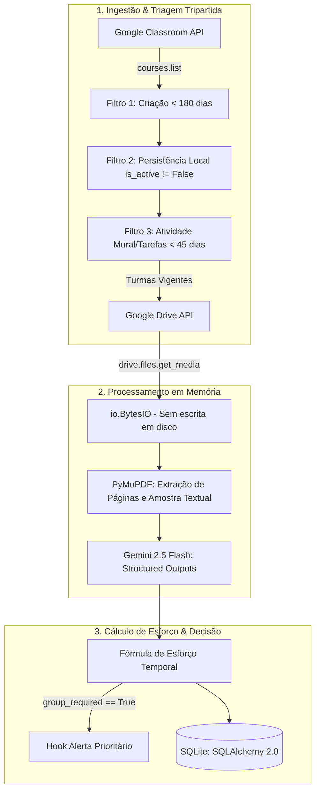

# 🎓 Assistente Acadêmico Autônomo & Agendamento Preditivo

Plataforma autônoma headless para gestão acadêmica, triagem inteligente de materiais do Google Workspace (Classroom, Drive, Calendar) e estimativa semântica de esforço temporal com IA (Gemini).

---

## 🚀 1. Visão Geral e Objetivo

O **Assistente Acadêmico Autônomo** é projetado para eliminar a sobrecarga de organização acadêmica de estudantes universitários. Ele atua como um agente em segundo plano que:

1. **Sincroniza e filtra** as turmas ativas do semestre letivo no Google Classroom.
2. **Identifica anexos PDF** de materiais de aula e enunciados de tarefas diretamente no Google Drive.
3. **Extrai texto em memória** (sem tocar o disco) com PyMuPDF.
4. **Avalia a complexidade cognitiva** e requisitos de produção via Gemini API (`gemini-2.5-flash`) com Structured Outputs.
5. **Calcula o tempo de dedicação real** com fórmulas calibradas e regras de negócio determinísticas.
6. **Emite alertas imediatos** para tarefas que exigem trabalho em grupo, divisão de seminários ou equipes.
7. **Persiste todo o ecossistema** de forma relacional em SQLite via SQLAlchemy 2.0.

---

## 🏗️ 2. Arquitetura da Solução (Fase 1 — SPEC-001)



### Componentes Principais

- **Persistência (`backend/app/core/` e `backend/app/models/db_models.py`):** Configuração moderna de engine e sessão SQLAlchemy 2.0 com SQLite.
- **Contratos e Schemas (`backend/app/models/schemas.py`):** Modelos Pydantic v2 com validação estrita, clamp numérico automático de densidade textual ($\kappa_{\text{densidade}} \in [1.0, 2.2]$) e configuração `ConfigDict(from_attributes=True)`.
- **Conector Google Workspace (`backend/app/services/google_client.py`):**
  - Autenticação OAuth2 com renovação preventiva de `refresh_token`.
  - **Triagem Tripartida:** Isola as 10 turmas vigentes descartando turmas antigas (> 180 dias sem flag ativa prévia), turmas com bloqueio local explícito (`is_active=False`) e turmas sem publicações recentes (> 45 dias sem atividade no mural/tarefas).
  - Download binário direto para `io.BytesIO` em RAM sem gravação de arquivos temporários em disco.
- **Analisador de Documentos (`backend/app/services/document_analyzer.py`):**
  - Leitura em memória de PDFs com PyMuPDF (`fitz`), capturando número total de páginas ($N_{\text{páginas}}$) e o extrato integral das duas primeiras páginas.
  - Avaliação semântica via SDK oficial `google-genai` com Structured Outputs (`SemanticTaskEvaluation`).
  - Motor determinístico de cálculo de esforço temporal:
    $$t_{\text{base}} = 3.0 \text{ min/página}$$
    $$\lambda_{\text{idioma}} = 1.35 \text{ (se estrangeiro) senão } 1.0$$
    $$T_{\text{leitura}} = \text{round}(N_{\text{páginas}} \times t_{\text{base}} \times \kappa_{\text{densidade}} \times \lambda_{\text{idioma}})$$
    $$T_{\text{total}} = T_{\text{leitura}} + T_{\text{produção}}$$
  - Disparo de hook configurável para emissão de alertas prioritários quando `group_required == True`.

---

## 🗄️ 3. Esquema das Tabelas do Banco de Dados

| Tabela | Coluna | Tipo | Restrições | Descrição |
| :--- | :--- | :--- | :--- | :--- |
| **`courses`** | `id` | VARCHAR(64) | Primary Key | ID oficial da turma no Google Classroom |
| | `name` | VARCHAR(255) | NOT NULL | Nome da disciplina |
| | `is_active` | BOOLEAN | DEFAULT TRUE | Filtra turmas ativas do semestre vigente |
| | `last_synced_at` | DATETIME | NULLABLE | Timestamp UTC da última sincronização |
| **`materials`** | `id` | VARCHAR(128) | Primary Key | ID do arquivo no Google Drive ou URL |
| | `course_id` | VARCHAR(64) | ForeignKey(`courses.id`) | Turma vinculada |
| | `title` | VARCHAR(255) | NOT NULL | Nome do material ou documento |
| | `page_count` | INTEGER | DEFAULT 0 | Contagem total de páginas do PDF |
| | `lexical_density` | FLOAT | DEFAULT 1.0 | Fator $\kappa$ de densidade textual calibrado |
| **`tasks`** | `id` | VARCHAR(64) | Primary Key | ID da tarefa no Classroom (`courseWork.id`) |
| | `course_id` | VARCHAR(64) | ForeignKey(`courses.id`) | Turma vinculada |
| | `title` | VARCHAR(255) | NOT NULL | Título do trabalho ou atividade |
| | `due_datetime` | DATETIME | NOT NULL | Data e hora de entrega |
| | `est_duration_min` | INTEGER | NOT NULL | Tempo total estimado em minutos ($T_{\text{total}}$) |
| | `group_required` | BOOLEAN | DEFAULT FALSE | Flag que indica exigência de trabalho em grupo |
| | `status` | VARCHAR(32) | DEFAULT 'PENDING' | Status (`PENDING`, `SCHEDULED`, `COMPLETED`) |
| **`calendar_allocations`** | `id` | INTEGER | PK, Autoincrement | Identificador do slot alocado |
| | `task_id` | VARCHAR(64) | ForeignKey(`tasks.id`) | Tarefa associada |
| | `gcal_event_id` | VARCHAR(128) | NOT NULL | ID do evento gerado no Google Calendar |
| | `start_time` | DATETIME | NOT NULL | Início do bloco de estudo |
| | `end_time` | DATETIME | NOT NULL | Término do bloco de estudo |
| **`domestic_routines`** | `id` | INTEGER | PK, Autoincrement | Identificador da rotina doméstica |
| | `name` | VARCHAR(128) | NOT NULL | Nome da atividade fixa |
| | `cron_expression` | VARCHAR(64) | NOT NULL | Expressão cron de recorrência (ex: `0 20 * * 2,4`) |
| | `last_completed` | DATETIME | NULLABLE | Data de conclusão mais recente |

---

## ⚙️ 4. Pré-requisitos e Configuração do Ambiente

### Requisitos
- **Python:** 3.11+ (homologado em Python 3.13)
- **Virtualenv:** `/root/.venv` (ou venv local de preferência)

### Instalação de Dependências
```bash
/root/.venv/bin/pip install --upgrade pip
/root/.venv/bin/pip install -r backend/requirements.txt
```

### Variáveis de Ambiente
Crie um arquivo `.env` (ignorado pelo git) com as seguintes configurações:
```bash
# Chave de acesso à API do Gemini
GEMINI_API_KEY="AIzaSy..."

# Caminhos das credenciais do Google Workspace OAuth2
GOOGLE_CREDENTIALS_PATH="credentials.json"
GOOGLE_TOKEN_PATH="token.json"

# String de conexão do banco de dados (SQLite por padrão)
DATABASE_URL="sqlite:///academic_platform.db"
```

---

## 🧪 5. Execução dos Testes com Pytest

A suíte de testes utiliza banco SQLite em memória (`sqlite:///:memory:`) e mocks completos das chamadas de rede da Google API e Gemini:

```bash
/root/.venv/bin/pytest -v tests/test_ingestion_and_analyzer.py
```

### Cobertura da Suíte de Testes
1. `test_schema_table_creation`: Garante a criação de todas as 5 tabelas e colunas no SQLAlchemy 2.0.
2. `test_filter_active_courses_discard_logic`: Valida os 3 filtros determinísticos de descarte de turmas inativas/antigas.
3. `test_in_memory_pdf_reading_no_disk`: Assegura a extração de páginas e texto estritamente em memória com PyMuPDF.
4. `test_effort_calculation_mathematics_and_clamp`: Valida o clamp $\kappa \in [1.0, 2.2]$, penalidade de língua estrangeira ($\lambda = 1.35$) e os tempos $T_{\text{leitura}}$ e $T_{\text{total}}$.
5. `test_priority_alert_and_persistence`: Testa o disparo do hook prioritário para trabalho em grupo e a persistência relacional completa.
6. `test_no_alert_when_group_not_required`: Confirma que tarefas individuais não acionam o alerta prioritário.
