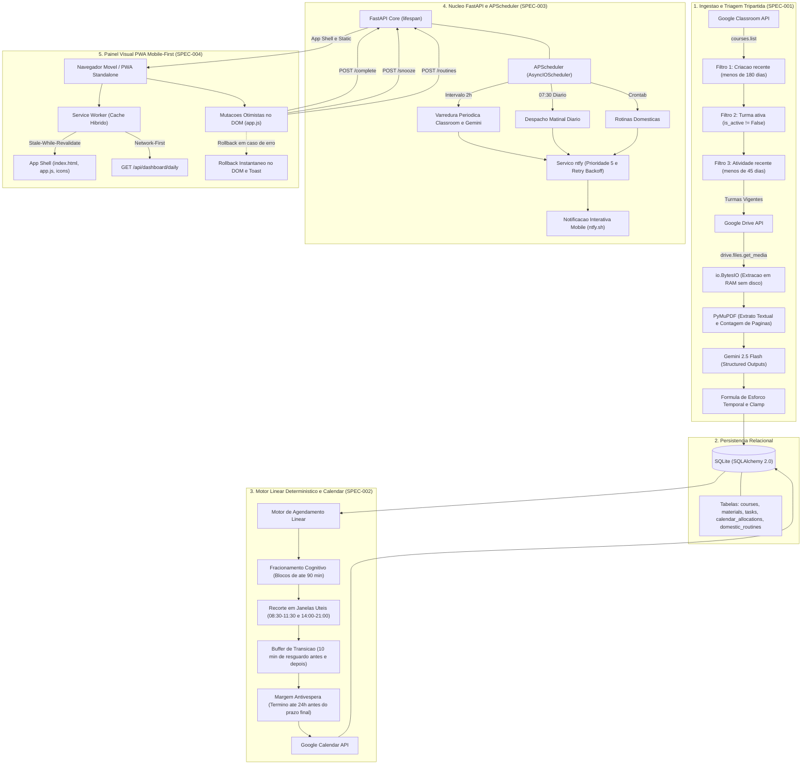

# 🎓 Assistente Acadêmico Autônomo & Agendamento Preditivo

<p align="center">
  
  
  
  
  
  
  
  
  
  
</p>

Plataforma autônoma headless e interface visual progressiva (PWA) para gestão acadêmica universitária, triagem inteligente de materiais do Google Workspace (Classroom, Drive, Calendar), estimativa cognitiva de esforço com IA (Gemini 2.5 Flash), agendamento preditivo determinístico, notificações interativas via protocolo **ntfy** e painel mobile-first com mutações otimistas.

---

## 🧭 Quadro Geral de Status do Projeto (Roadmap Kanban)

| Especificação | Escopo & Tecnologia | Status | Cobertura de Testes |
| :--- | :--- | :---: | :---: |
| **SPEC-001** | Ingestão Tripartida (Google Classroom/Drive), Leitura de PDFs em RAM (`io.BytesIO` com PyMuPDF) e Avaliação Cognitiva via Gemini 2.5 Flash Structured Outputs | **✅ Concluído** | 7 Testes Unitários/Integração |
| **SPEC-002** | Motor Determinístico Linear de Agendamento, Fracionamento Cognitivo ($\le 90$ min), Resguardo de 10 min, Margem Antivéspera de 24h e Sincronização Google Calendar | **✅ Concluído** | 7 Testes de Algoritmo/Agenda |
| **SPEC-003** | Núcleo FastAPI com Gerenciador de Ciclo de Vida (`lifespan`), APScheduler (Varredura 2h + Despacho 07:30 + Crons Domésticos), Mensageria ntfy (Ações Táteis) e Endpoints REST | **✅ Concluído** | 16 Testes de API & Notifier |
| **SPEC-004 & QA** | Painel Visual Responsivo PWA Mobile-First, Vanilla JavaScript (ES6+), Tailwind CSS, Service Worker, Mutações Otimistas e Teste de Fumaça Ponta a Ponta (E2E) | **✅ Concluído** | 6 Testes de PWA & E2E |
| **Total Consolidado** | **Pipeline Completo de Ponta a Ponta** | **🏆 v1.0.0** | **36/36 Testes (100% Passed)** |

---

## 🏗️ 1. Arquitetura da Solução de Ponta a Ponta



---

## 🧩 2. Especificações Técnicas por Fase

### Fase 1 — Ingestão Inteligente & Avaliação Cognitiva (SPEC-001)
- **Persistência Relacional (`backend/app/core/` e `backend/app/models/db_models.py`):** Configuração moderna de engine e sessão SQLAlchemy 2.0 com SQLite em conformidade estrita de tipos e integridade referencial.
- **Contratos e Schemas (`backend/app/models/schemas.py`):** Modelos Pydantic v2 com validação estrita, clamp numérico automático de densidade textual ($\kappa_{\text{densidade}} \in [1.0, 2.2]$) e configuração `ConfigDict(from_attributes=True)`.
- **Conector Google Workspace (`backend/app/services/google_client.py`):**
  - Autenticação OAuth2 com renovação preventiva de `refresh_token`.
  - **Triagem Tripartida:** Isola as turmas vigentes descartando turmas antigas (> 180 dias sem flag ativa prévia), turmas com bloqueio local explícito (`is_active=False`) e turmas sem publicações recentes (> 45 dias sem atividade no mural/tarefas).
  - Download binário direto para `io.BytesIO` em RAM sem gravação de arquivos temporários em disco.
- **Analisador de Documentos (`backend/app/services/document_analyzer.py`):**
  - Leitura em memória de PDFs com PyMuPDF (`fitz`), capturando número total de páginas ($N_{\text{paginas}}$) e o extrato integral das duas primeiras páginas.
  - Avaliação semântica via SDK oficial `google-genai` com Structured Outputs (`SemanticTaskEvaluation`).
  - Motor determinístico de cálculo de esforço temporal:
    $$t_{\text{base}} = 3.5 \text{ min/pagina}$$
    $$\gamma_{\text{lang}} = 1.4 \text{ (se estrangeiro) senao } 1.0$$
    $$T_{\text{leitura}} = \lceil N_{\text{paginas}} \times t_{\text{base}} \times \kappa_{\text{densidade}} \times \gamma_{\text{lang}} \rceil$$
    $$T_{\text{total}} = T_{\text{leitura}} + T_{\text{producao}}$$
  - Disparo de hook configurável para emissão de alertas prioritários quando `group_required == True`.

### Fase 2 — Motor de Agendamento Linear & Sincronização Google Calendar (SPEC-002)
- **Motor Linear de Alocação (`backend/app/services/scheduler_engine.py`):**
  - **Fracionamento Cognitivo:** Tarefas com $T_{\text{total}} \le 90$ minutos são alocadas em um bloco único. Tarefas $> 90$ minutos são fracionadas de forma equilibrada em $k = \lceil T_{\text{total}} / 75 \rceil$ blocos iguais de $d_{\text{bloco}} = \lceil T_{\text{total}} / k \rceil$ minutos (ex.: 140 min $\rightarrow$ 2 blocos de 70 min; 160 min $\rightarrow$ 3 blocos de 54 min).
  - **Janelas Diárias Permitidas:** Alocação restrita a horários produtivos saudáveis: matutino (**08:30 às 11:30**) e vespertino/noturno (**14:00 às 21:00**), priorizando dias intercalados.
  - **Buffer de Transição Contínuo:** Cada bloco exige $d_{\text{bloco}} + 20$ minutos contínuos na agenda (10 min de resguardo antes e 10 min depois).
  - **Margem Antivéspera Rígida de 24h:** O término do último bloco de estudo deve ocorrer obrigatoriamente antes de $\text{due\_datetime} - 24\text{h}$.
  - **Tratamento de Exceções Determinístico:** Lança `InsufficientScheduleWindowError` se o prazo violar a margem antivéspera e `ScheduleCapacityExceededError` se a agenda estiver saturada, evitando alocações parciais inconsistentes.
- **Sincronização Bidirecional (`backend/app/services/calendar_sync.py`):**
  - Consulta `freebusy.query` no Google Calendar consolidando compromissos existentes.
  - Persistência atômica dos blocos em `calendar_allocations` com links diretos para a atividade no Google Classroom e anexos no Google Drive.
  - Idempotência total contra eventos duplicados.

### Fase 3 — Núcleo FastAPI, Gestão de Ciclo de Vida & Mensageria ntfy (SPEC-003)
- **Núcleo do Servidor Autônomo (`backend/app/main.py`):**
  - Gerenciador de ciclo de vida assíncrono nativo `lifespan(app: FastAPI)` com inicialização automática do banco relacional (`init_db()`).
  - **APScheduler Integrado (`AsyncIOScheduler`):**
    - **Varredura Periódica a cada 2h (`IntervalTrigger(hours=2)`):** Sincroniza turmas ativas do Classroom, processa novos PDFs no Gemini (alerta urgente se `group_required == True`) e agenda tarefas `PENDING` no Calendar.
    - **Despacho Matinal Diário às 07:30 (`CronTrigger(hour=7, minute=30)`):** Consulta alocações do dia, fila de leitura e rotinas residenciais, enviando briefing consolidado.
    - **Rotinas Domésticas:** Carrega expressões crontab cadastradas em `domestic_routines` e agenda triggers individuais (`CronTrigger.from_crontab`).
    - Drenagem e encerramento gracioso do agendador (`wait=True`) sem perda de estado.
- **Mensageria e Protocolo ntfy (`backend/app/services/notifier.py`):**
  - Publicação assíncrona com `httpx.AsyncClient` com timeout estrito de **10 segundos**.
  - **Tolerância a oscilações de rede:** Algoritmo de retentativas com **recuo exponencial (exponential backoff)** (3 tentativas), preservando o estado local consistente.
  - **Cabeçalhos ntfy:** `Priority: 5` (urgente para despertar o ecrã e contornar Doze Mode no Android), tags com emojis contextuais e ações interativas (`http, Concluir`, `http, Adiar 1h`, `view, Abrir PDF`).

### Fase 4 — Painel Visual PWA Mobile-First & Mutações Otimistas (SPEC-004)
- **Entrega de Arquivos Estáticos & PWA no FastAPI (`backend/app/main.py`):**
  - Servimento do App Shell em `GET /` (`FileResponse` de `static/index.html`).
  - Rota de escopo raiz para o Service Worker (`GET /service-worker.js`) com cabeçalho `Service-Worker-Allowed: /`.
  - Manifesto W3C servido em `GET /manifest.json` com `media_type="application/manifest+json"`.
  - Montagem de ativos estáticos, fontes e ícones em `/static` (`StaticFiles`).
- **Interface Mobile-First & Vanilla ES6+ (`backend/app/static/`):**
  - Interface moderna desenvolvida sem bundlers complexos (zero Node/Vite/Webpack), estilizada com Tailwind CSS em paleta dark slate com suporte a safe areas de dispositivos móveis.
  - Alvos táteis com altura e largura mínimas de 44x44px.
  - **Três Seções Principais Integradas:**
    1. **Grelha de Aulas e Blocos de Estudo (`#daily-schedule-section`):** Visualização cronológica do dia com badges de disciplina e horários de início e término.
    2. **Fila Ordenada de Leitura (`#reading-queue-section`):** Cards por prazo com contagem regressiva de páginas, cálculo estimado de tempo em minutos, destaque para trabalho em grupo (`group_required`) e botões de ação imediata: **Concluir**, **Adiar 1h** e **Abrir PDF**.
    3. **Manutenção Doméstica & Rotinas (`#domestic-routines-section`):** Exibição de periodicidade cron, status de conclusão diária e botão de validação tátil.
- **Estratégias Avançadas do Service Worker (`service-worker.js`):**
  - **Stale-While-Revalidate:** Aplicado a ativos estáticos e navegação do App Shell, entregando o cache instantaneamente e atualizando os recursos em background.
  - **Network-First:** Aplicado à consulta de dados em tempo real (`GET /api/dashboard/daily`), com fallback resiliente para o cache local offline quando o dispositivo perde a rede.
  - **Network Pass-Through:** Mutações `POST /api/...` trafegam direto pela rede sem retenção ou inconsistência de cache.
- **Mutações Otimistas (Optimistic UI Updates) & Rollback (`app.js`):**
  - Transições visuais e contadores recalculados instantaneamente no DOM ao interagir com **Concluir** ou **Adiar 1h**.
  - Mecanismo de **Snapshot e Rollback**: em caso de falha de rede ou rejeição pelo servidor (`409 Conflict`), o elemento retorna ao estado original e um toast contextual é exibido.

---

## 📡 3. Especificação dos Contratos da API REST

| Método | Rota | Descrição Técnica | Parâmetros / Payload | Resposta de Sucesso | Tratamento de Erro |
| :---: | :--- | :--- | :--- | :--- | :--- |
| `GET` | `/` | Serve o App Shell do PWA | — | `200 OK` (`text/html`) | `404` se ausente |
| `GET` | `/manifest.json` | Manifesto W3C PWA Standalone | — | `200 OK` (`application/manifest+json`) | `404` se ausente |
| `GET` | `/service-worker.js` | Service Worker com escopo raiz | Header: `Service-Worker-Allowed: /` | `200 OK` (`application/javascript`) | `404` se ausente |
| `GET` | `/static/{file_path}` | Ativos estáticos e ícones | — | `200 OK` (MIME apropriado) | `404` se ausente |
| `GET` | `/health` | Integridade do backend e scheduler | — | `200 OK` JSON com telemetria de jobs | `500` se offline |
| `GET` | `/api/dashboard/daily` | Payload consolidado da jornada diária | `?date=YYYY-MM-DD` (opcional) | `200 OK` com alocações, fila de leitura e rotinas | `400` para data inválida |
| `POST` | `/api/tasks/{task_id}/complete` | Transição atômica para status `COMPLETED` | `task_id` na URL | `200 OK` com modelo da tarefa | `404` se inexistente |
| `POST` | `/api/tasks/{task_id}/snooze` | Adia a tarefa recalculando blocos lineares | `?min=60` (padrão: 60) | `200 OK` com novas alocações | `404` (inexistente) / `409 Conflict` (janela saturada ou <24h) |
| `POST` | `/api/routines/{routine_id}/complete` | Atualiza carimbo `last_completed` da rotina | `routine_id` na URL | `200 OK` com modelo da rotina | `404` se inexistente |

---

## 🗄️ 4. Esquema Relacional do Banco de Dados (SQLite / SQLAlchemy 2.0)

| Tabela | Coluna | Tipo | Restrições | Descrição |
| :--- | :--- | :--- | :--- | :--- |
| **`courses`** | `id` | VARCHAR(64) | Primary Key | ID oficial da turma no Google Classroom |
| | `name` | VARCHAR(255) | NOT NULL | Nome da disciplina |
| | `is_active` | BOOLEAN | DEFAULT TRUE | Filtra turmas ativas do semestre vigente |
| | `last_synced_at` | DATETIME | NULLABLE | Timestamp UTC da última sincronização |
| **`materials`** | `id` | VARCHAR(128) | Primary Key | ID do arquivo no Google Drive ou URL |
| | `course_id` | VARCHAR(64) | ForeignKey(`courses.id`) | Turma vinculada |
| | `title` | VARCHAR(255) | NOT NULL | Nome do material ou documento |
| | `page_count` | INTEGER | DEFAULT 0 | Contagem total de páginas do PDF |
| | `lexical_density` | FLOAT | DEFAULT 1.0 | Fator $\kappa$ de densidade textual calibrado |
| **`tasks`** | `id` | VARCHAR(64) | Primary Key | ID da tarefa no Classroom (`courseWork.id`) |
| | `course_id` | VARCHAR(64) | ForeignKey(`courses.id`) | Turma vinculada |
| | `title` | VARCHAR(255) | NOT NULL | Título do trabalho ou atividade |
| | `due_datetime` | DATETIME | NOT NULL | Data e hora de entrega |
| | `est_duration_min` | INTEGER | NOT NULL | Tempo total estimado em minutos ($T_{\text{total}}$) |
| | `group_required` | BOOLEAN | DEFAULT FALSE | Flag que indica exigência de trabalho em grupo |
| | `status` | VARCHAR(32) | DEFAULT 'PENDING' | Status (`PENDING`, `SCHEDULED`, `COMPLETED`) |
| **`calendar_allocations`** | `id` | INTEGER | PK, Autoincrement | Identificador do slot alocado |
| | `task_id` | VARCHAR(64) | ForeignKey(`tasks.id`) | Tarefa associada |
| | `gcal_event_id` | VARCHAR(128) | NOT NULL | ID do evento gerado no Google Calendar |
| | `start_time` | DATETIME | NOT NULL | Início do bloco de estudo |
| | `end_time` | DATETIME | NOT NULL | Término do bloco de estudo |
| **`domestic_routines`** | `id` | INTEGER | PK, Autoincrement | Identificador da rotina residencial |
| | `name` | VARCHAR(128) | NOT NULL | Nome da tarefa doméstica |
| | `cron_expression` | VARCHAR(64) | NOT NULL | Expressão crontab periódica |
| | `last_completed` | DATETIME | NULLABLE | Carimbo UTC da última conclusão |

---

## ⚙️ 5. Configuração e Variáveis de Ambiente

Crie o arquivo `.env` na raiz do projeto com base nas seguintes diretivas:

```env
# Chave Oficial da API Gemini (Google AI Studio)
GEMINI_API_KEY="AIzaSyYourKeyHere"

# Caminhos do OAuth2 do Google Workspace
GOOGLE_CREDENTIALS_FILE="credentials.json"
GOOGLE_TOKEN_FILE="token.json"

# Banco de Dados SQLite Relacional
DATABASE_URL="sqlite:///./backend/academic_platform.db"

# Parâmetros do Protocolo ntfy
NTFY_SERVER_URL="https://ntfy.sh"
NTFY_TOPIC="assistente_academico_dev"
PUBLIC_API_BASE_URL="http://localhost:8000"

# Fuso Horário Canônico
TIMEZONE="America/Sao_Paulo"
```

---

## 🚀 6. Como Executar a Aplicação e Instalar o PWA

### 6.1 Execução do Backend e Painel Web
```bash
# Navegue até o diretório do projeto
cd /work/assistente-academico

# Inicie o servidor FastAPI via Uvicorn
/root/.venv/bin/uvicorn backend.app.main:app --host 0.0.0.0 --port 8000 --reload
```
Acesse a aplicação no navegador móvel ou desktop em: `http://localhost:8000/`.

### 6.2 Execução com Docker & Docker Compose
A aplicação possui imagem otimizada não-root com healthcheck para execução local ou deploy via Komodo / OMV:

```bash
# 1. Copie o arquivo de variáveis de ambiente
cp .env.example .env

# 2. Suba o container com build automático
docker compose up -d --build

# 3. Verifique os logs e a integridade da aplicação
docker compose ps
docker compose logs -f
```

### 6.3 Instalação no Celular (Add to Home Screen - A2HS)
- **Android (Google Chrome):**
  1. Abra `http://<IP_OU_HOST>:8000/`.
  2. O navegador exibirá a barra "Adicionar AcadAgent à tela inicial" ou acesse o menu de 3 pontos e toque em **"Instalar aplicativo"**.
  3. O aplicativo funcionará em tela cheia (`standalone`), sem barras de navegação do browser.
- **iOS (Apple Safari):**
  1. Abra `http://<IP_OU_HOST>:8000/` no Safari.
  2. Toque no ícone de compartilhamento (quadrado com seta).
  3. Selecione **"Adicionar à Tela de Início"** e confirme.

---

## 🧪 7. Validação e Execução dos Testes Automatizados

A suíte de testes utiliza banco SQLite em memória isolado (`sqlite:///:memory:` com `StaticPool`) e mocks completos das chamadas de rede da Google API (Classroom, Drive, Calendar), Gemini e ntfy:

```bash
# Executa todos os testes do projeto (SPEC-001 a SPEC-004 + E2E Smoke Test)
/root/.venv/bin/pytest -v tests/

# Verificação de Tipagem Estrita (Zero Erros)
/root/.venv/bin/mypy backend/app
```

### Cobertura da Suíte de Testes (36 Testes Unitários, Regressão e E2E)

#### Ingestão e Análise Semântica (SPEC-001):
1. `test_schema_table_creation`: Garante a criação de todas as 5 tabelas e colunas no SQLAlchemy 2.0.
2. `test_filter_active_courses_discard_logic`: Valida os 3 filtros determinísticos de descarte de turmas inativas/antigas.
3. `test_in_memory_pdf_reading_no_disk`: Assegura a extração de páginas e texto estritamente em memória com PyMuPDF.
4. `test_effort_calculation_mathematics_and_clamp`: Valida o clamp $\kappa \in [1.0, 2.2]$, penalidade de língua estrangeira ($\gamma_{\text{lang}} = 1.4$) e os tempos $T_{\text{leitura}}$ e $T_{\text{total}}$.
5. `test_priority_alert_and_persistence`: Testa o disparo do hook prioritário para trabalho em grupo e a persistência relacional completa.
6. `test_no_alert_when_group_not_required`: Confirma que tarefas individuais não acionam o alerta prioritário.
7. `test_oauth_refresh_failure_triggers_emergency_alert`: Garante disparo imediato do alerta de emergência via ntfy quando a renovação do `refresh_token` OAuth2 falha.

#### Motor de Agendamento Linear e Sincronização Google Calendar (SPEC-002):
8. `test_cognitive_chunking_math`: Valida o fracionamento em blocos ($\le 90$ min vs $> 90$ min, ex: 140 min $\rightarrow$ 2 de 70 min; 160 min $\rightarrow$ 3 de 54 min).
9. `test_busy_intervals_merging_and_window_subtraction`: Valida a fusão de intervalos ocupados do Calendar e recorte nas janelas permitidas (08:30–11:30 e 14:00–21:00).
10. `test_mandatory_10min_transition_buffer`: Garante que blocos exigem $d_{\text{bloco}} + 20$ min contínuos, com 10 min de resguardo antes e depois.
11. `test_antivespera_24h_margin_and_insufficient_window`: Garante término $\le \text{due} - 24\text{h}$ e lança `InsufficientScheduleWindowError` se inviável.
12. `test_schedule_capacity_exceeded_error_when_saturated`: Confirma disparo de `ScheduleCapacityExceededError` sem marcações parciais se a agenda estiver lotada.
13. `test_calendar_sync_and_persistence_mocked`: Valida persistência atômica em `calendar_allocations`, status `'SCHEDULED'`, metadados do evento e idempotência contra duplicatas.
14. `test_mixed_naive_and_aware_datetimes_no_typeerror`: Previne `TypeError` ao cruzar datetimes `offset-naive` (SQLite) com `offset-aware` (UTC/Google API).

#### Núcleo FastAPI, APScheduler e Mensageria ntfy (SPEC-003):
15. `test_complete_task_endpoint`: Transição transacional para `COMPLETED` e tratamento de 404 para tarefas inexistentes.
16. `test_snooze_task_endpoint_success`: Recálculo linear do agendamento com recuo no tempo e geração de novos blocos.
17. `test_snooze_task_conflict_insufficient_window`: Disparo de `409 Conflict` quando o snooze viola a margem antivéspera de 24h.
18. `test_complete_routine_endpoint`: Atualização transacional de `last_completed` em `domestic_routines`.
19. `test_daily_dashboard_endpoint`: Validação estrita do payload completo do dashboard da jornada diária.
20. `test_daily_dashboard_invalid_date`: Tratamento de erro `400 Bad Request` para strings de data malformadas.
21. `test_notifier_study_block_alert_headers_and_actions`: Formatação correta dos cabeçalhos ntfy (`Priority: 5`, `Tags` e `Actions` interativas).
22. `test_notifier_domestic_routine_alert_contract`: Validação do contrato do botão de confirmação de rotina doméstica.
23. `test_notifier_group_urgent_alert`: Validação do alerta de prioridade máxima para trabalho em grupo.
24. `test_notifier_oauth_emergency_alert`: Formatação do despacho de emergência por revogação/expiração de token.
25. `test_notifier_retry_and_backoff_transient_failure`: Tolerância a falhas com 2 falhas de rede simuladas e sucesso na 3ª tentativa.
26. `test_notifier_exhausted_retries_resilience`: Resiliência contra quedas permanentes sem quebra de fluxo na aplicação.
27. `test_healthcheck_endpoint`: Verificação de integridade e telemetria dos jobs do agendador em `GET /health`.
28. `test_lifespan_initialization_and_shutdown`: Inicialização do SQLite, registro de jobs no `AsyncIOScheduler` e drenagem limpa no encerramento.
29. `test_dashboard_no_duplicate_tasks_with_multiple_course_materials`: Garante ausência de duplicação na `reading_queue` quando uma disciplina possui múltiplos materiais.
30. `test_snooze_failure_preserves_existing_allocations_atomicity`: Garante que falhas `409 Conflict` no snooze preservam intactas as alocações anteriores no banco.

#### Painel Visual PWA, Ativos Estáticos e Fumaça E2E (SPEC-004 & QA):
31. `test_root_index_html_delivery`: Entrega de `index.html` em `GET /` com links de PWA e os 3 containers estruturais de seções.
32. `test_manifest_json_specification`: Conformidade com o padrão W3C Web App Manifest (`standalone`, escopo raiz e múltiplos ícones maskable).
33. `test_service_worker_delivery_and_headers`: Entrega de `service-worker.js` com cabeçalho `Service-Worker-Allowed: /` e lógica de cache híbrido.
34. `test_static_files_mount_and_app_js`: Acesso direto aos ativos estáticos montados (`/static/app.js`, `/static/icons/`) e integridade dos handlers JavaScript.
35. `test_all_precache_and_manifest_assets_exist_no_404`: Verifica que todos os ativos do pre-cache do Service Worker e ícones do Manifesto respondem `200 OK`.
36. `test_full_e2e_pipeline_smoke`: Teste ponta a ponta simulando ingestão de PDF de 30 páginas, avaliação Gemini, alocação Calendar, dashboard diário e mutações REST.

